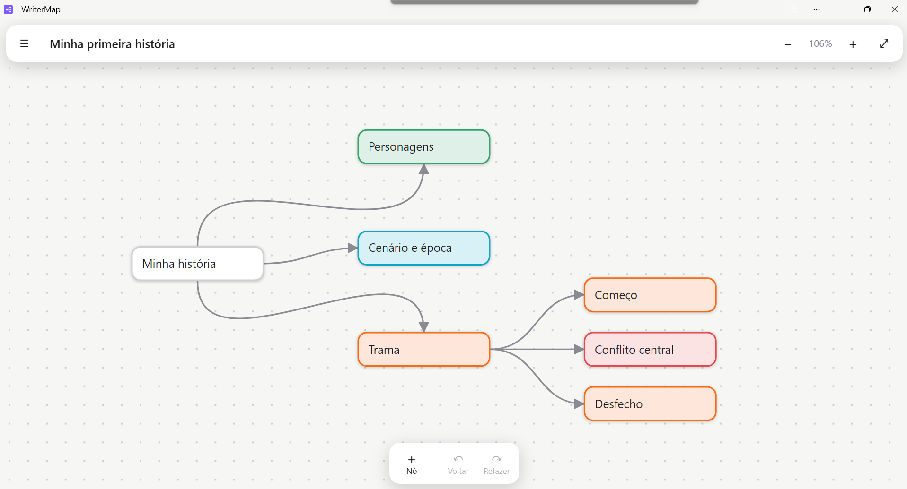

# 🗺️ WriterMap

**Mapas mentais visuais para escritores esboçarem suas histórias.**

O WriterMap é um aplicativo web (PWA) simples e rápido para planejar enredos, personagens, cenários e capítulos em um mapa visual, no estilo dos mapas mentais do Obsidian. Ele funciona no celular, tablet e computador, pode ser instalado como um app e **funciona sem internet**.
---

## Sumário

1. [Visão geral](#1-visão-geral)
2. [Instalação e uso](#2-instalação-e-uso)
3. [Conhecendo a tela](#3-conhecendo-a-tela)
4. [Primeiros passos](#4-primeiros-passos)
5. [Caixas](#5-caixas)
6. [Ligações (linhas e setas)](#6-ligações-linhas-e-setas)
7. [Cores para a sua história](#7-cores-para-a-sua-história)
8. [Mover a tela e dar zoom](#8-mover-a-tela-e-dar-zoom)
9. [Desfazer e refazer](#9-desfazer-e-refazer)
10. [Vários mapas](#10-vários-mapas)
11. [Exportar, importar e backup](#11-exportar-importar-e-backup)
12. [Atalhos de teclado](#12-atalhos-de-teclado)
13. [Dicas para escritores](#13-dicas-para-escritores)
14. [Publicar no GitHub Pages](#14-publicar-no-github-pages)
15. [Atualizar o app depois de publicado](#15-atualizar-o-app-depois-de-publicado)
16. [Solução de problemas](#16-solução-de-problemas)
17. [Limites e privacidade](#17-limites-e-privacidade)
18. [Estrutura dos arquivos](#18-estrutura-dos-arquivos)


---

## 1. Visão geral

| Recurso | Descrição |
|---|---|
| Tela infinita | Mova e dê zoom livremente, de 20% a 300% |
| Caixas responsivas | A altura cresce conforme o texto e a largura é ajustável |
| Ligações | Linhas curvas com seta, que acompanham as caixas |
| Cores de história | Conflito, Cena, Ideia, Personagem, Local e Tema |
| Vários mapas | Um mapa para cada livro, conto ou ideia |
| Desfazer/Refazer | Até 150 passos por mapa aberto |
| Salvamento automático | Tudo fica salvo no aparelho |
| Offline | Funciona sem internet depois do primeiro acesso |
| Exportar | Mapa completo em `.json` e esboço em texto `.md` |
| Instalável | Vira um app na tela inicial ou na área de trabalho |



---

## 2. Instalação e uso

O WriterMap pode ser usado direto no navegador ou instalado como app.

### Android (Chrome)
1. Abra o endereço do app.
2. Toque em **☰** e depois em **📲 Instalar o app**. Se o botão não aparecer, use o menu do Chrome (⋮) e escolha **Instalar app** ou **Adicionar à tela inicial**.

### iPhone e iPad (Safari)
1. Abra o endereço do app no **Safari**.
2. Toque no botão **Compartilhar**.
3. Escolha **Adicionar à Tela de Início**.

### Computador (Chrome ou Edge)
1. Abra o endereço do app.
2. Clique no ícone de instalação na barra de endereços, ou no botão **📲 Instalar o app** do menu ☰.

> Depois do primeiro acesso, o app fica guardado no aparelho e abre mesmo sem internet.

---

## 3. Conhecendo a tela

```
┌──────────────────────────────────────────┐
│ ☰  Nome do mapa              −  100% ＋ ⤢ │  ← Barra superior
│                                          │
│            (tela de desenho)             │
│                                          │
│ [＋Nó][↳Filho][⇣Irmão][✎Editar] ●●●●●●● … │  ← Barra de ferramentas
└──────────────────────────────────────────┘
```

**Barra superior**
- **☰** abre o menu de mapas (criar, trocar, exportar, importar, instalar e ajuda).
- **Nome do mapa** pode ser editado direto: toque nele, digite e confirme.
- **− / ＋** diminuem e aumentam o zoom. **⤢** ajusta o mapa inteiro na tela.

**Barra de ferramentas (parte de baixo)**
- Mostra só o que faz sentido para o que está selecionado.
- Em telas pequenas, deslize a barra para os lados para ver todos os botões.

| Botão | Aparece quando | O que faz |
|---|---|---|
| ＋ Nó | Sempre | Cria uma caixa nova no centro da tela |
| ↳ Filho | Caixa selecionada | Cria uma caixa ligada à direita da selecionada |
| ⇣ Irmão | Caixa selecionada | Cria outra caixa com o mesmo "pai" |
| ✎ Editar | Caixa selecionada | Edita o texto da caixa |
| ● Cores | Caixa selecionada | Muda a cor da caixa |
| ⇄ Inverter | Linha selecionada | Inverte a direção da seta |
| 🗑 Excluir | Algo selecionado | Exclui a caixa ou a linha |
| ↶ Voltar / ↷ Refazer | Sempre | Desfaz e refaz alterações |

---

## 4. Primeiros passos

Na primeira vez, o app abre com um **mapa de exemplo** ("Minha primeira história") com uma estrutura básica: Personagens, Cenário e época, e Trama (com Começo, Conflito central e Desfecho). Você pode editar, apagar ou ampliar tudo.

**Receita rápida para montar um mapa novo:**
1. Abra **☰ → ＋ Novo mapa**. Ele nasce com uma caixa "Ideia central".
2. Toque duas vezes na caixa e escreva o título da história.
3. Com a caixa selecionada, toque em **↳ Filho** e escreva (por exemplo: *Protagonista*).
4. Toque em **⇣ Irmão** para criar outra caixa do mesmo nível (por exemplo: *Antagonista*).
5. Continue ramificando: personagens, locais, capítulos, reviravoltas.
6. Dê cores às caixas para enxergar o equilíbrio da história de relance.

---

## 5. Caixas

### Criar
- **＋ Nó**: caixa solta no centro da tela.
- **↳ Filho** (ou tecla `Tab`): nova caixa ligada à direita da selecionada. Ela herda a cor da caixa de origem.
- **⇣ Irmão** (ou `Shift+Enter`): nova caixa ligada ao mesmo pai. Se a caixa não tiver pai, cria uma caixa logo abaixo.
- **Arrastar a bolinha para um espaço vazio**: cria uma caixa nova já ligada (veja a seção 6).

O app evita sobrepor caixas: ao criar, ele procura um espaço livre.

### Selecionar
Toque (ou clique) na caixa. Uma borda roxa indica que ela está selecionada.

### Editar o texto
- **Dois toques** (ou duplo clique) na caixa, ou botão **✎ Editar**, ou tecla `Enter`.
- Enquanto edita:
  - `Enter` salva o texto.
  - `Shift+Enter` quebra a linha (a caixa cresce sozinha).
  - `Esc` salva e sai da edição.
  - `Tab` salva e já cria uma caixa filha.
- Tocar fora da caixa também salva.
- Se você criar uma caixa e sair **sem escrever nada**, ela é descartada automaticamente.
- Ao colar texto, o app cola sempre como **texto simples**, sem formatação.
- O corretor ortográfico do navegador funciona durante a edição.

### Mover
Arraste a caixa com o dedo ou o mouse. As linhas ligadas a ela acompanham o movimento.

### Mudar a largura
Com a caixa selecionada, arraste o **canto inferior direito** (marcador roxo em "L"). A largura vai de 80 a 520 pixels. A altura se ajusta automaticamente ao texto.

### Excluir
Selecione a caixa e toque em **🗑 Excluir** (ou tecla `Delete`/`Backspace`). As linhas ligadas a ela também são removidas. Se excluir sem querer, use **↶ Voltar**.

---

## 6. Ligações (linhas e setas)

### Ligar duas caixas
1. Selecione a caixa de origem. Uma **bolinha roxa com "+"** aparece na lateral direita. No computador, ela também aparece ao passar o mouse.
2. **Arraste a bolinha** até outra caixa e solte.
3. Uma linha curva com seta é criada, da caixa de origem para a de destino.

Durante o arrasto, uma linha tracejada acompanha seu dedo e a caixa de destino é destacada.

### Criar caixa nova já ligada
Arraste a bolinha e **solte em um espaço vazio**. Nasce uma caixa nova no local, ligada à origem, já pronta para você digitar.

### Regras
- Não é possível ligar uma caixa a ela mesma.
- Duas caixas só podem ter **uma** ligação entre elas (em qualquer direção). Se tentar repetir, o app avisa.
- As linhas escolhem sozinhas o melhor lado de cada caixa (lateral, em cima ou embaixo), conforme a posição relativa.

### Selecionar, inverter e excluir uma linha
- Toque sobre a linha (a área de toque é generosa). Ela fica roxa.
- **⇄ Inverter** troca a direção da seta.
- **🗑 Excluir** remove só a linha, sem apagar as caixas.

---

## 7. Cores para a sua história

Selecione uma caixa e toque em uma das bolinhas coloridas:

| Cor | Significado sugerido | Uso |
|---|---|---|
| ⚪ Neutro | Geral | Títulos, anotações soltas |
| 🔴 Vermelho | **Conflito** | Problemas, obstáculos, antagonistas |
| 🟠 Laranja | **Cena** | Cenas e capítulos |
| 🟡 Amarelo | **Ideia** | Ideias soltas, possibilidades, dúvidas |
| 🟢 Verde | **Personagem** | Protagonistas, secundários, relações |
| 🔵 Azul | **Local** | Cenários, épocas, mundo |
| 🟣 Roxo | **Tema** | Mensagens, símbolos, motivos |

Os significados são sugestões. Você pode usar as cores como quiser. Ao exportar o esboço em `.md`, o nome da cor aparece como etiqueta em cada item (por exemplo, `[Personagem]`).

---

## 8. Mover a tela e dar zoom

| Ação | Celular/Tablet | Computador |
|---|---|---|
| Mover a tela | Arraste o fundo com um dedo | Arraste o fundo com o mouse |
| Zoom | Pinça com dois dedos | Roda do mouse (sobre o ponto desejado) |
| Zoom por botões | − e ＋ no topo | − e ＋ no topo |
| Ver tudo | Botão ⤢ | Botão ⤢ ou `Ctrl+0` |

O zoom vai de 20% a 300%. O app lembra a posição e o zoom de cada mapa.

---

## 9. Desfazer e refazer

- **↶ Voltar** ou `Ctrl+Z` desfaz a última alteração.
- **↷ Refazer** ou `Ctrl+Shift+Z` (ou `Ctrl+Y`) refaz.
- Cada mapa guarda até **150 passos** enquanto está aberto.
- Registram-se como passos: criar, excluir, mover, redimensionar, editar texto, mudar cor, ligar e inverter.
- Mover a tela e dar zoom **não** entram no histórico.
- O histórico é reiniciado quando você troca de mapa ou fecha o app, mas o conteúdo continua salvo.

---

## 10. Vários mapas

Abra o menu **☰** para gerenciar seus mapas.

- **Trocar de mapa:** toque no nome dele na lista.
- **Novo mapa:** botão **＋ Novo mapa**.
- **Renomear:** edite o nome na barra superior.
- **Excluir:** toque em **🗑** ao lado do mapa e confirme. Essa ação **não pode ser desfeita**.
- Se você excluir todos os mapas, o app cria automaticamente o mapa de exemplo.

Sugestão: um mapa por livro, e mapas separados para universo/mundo, personagens ou cronologia.

---

## 11. Exportar, importar e backup

No menu **☰**:

### ⬇ Exportar mapa (.json)
Salva o mapa **completo** (caixas, posições, cores, ligações e zoom) em um arquivo `nome-do-mapa.writermap.json`. É o seu **backup**. Guarde em nuvem, e-mail ou pendrive.

### ⬇ Exportar esboço (.md)
Gera um **texto em tópicos** a partir do mapa, pronto para virar roteiro ou capítulo.
- As caixas que não recebem nenhuma seta são os "pontos de partida".
- Os filhos aparecem em ordem **de cima para baixo** na tela. Por isso, organize verticalmente a sequência da história.
- Caixas coloridas recebem uma etiqueta, por exemplo `[Conflito]`.
- Caixas ligadas em círculo aparecem marcadas com `↺` para não repetir infinitamente.

Exemplo de resultado:

```markdown
# Minha primeira história

- Minha história
  - [Personagem] Personagens
  - [Local] Cenário e época
  - [Cena] Trama
    - [Cena] Começo
    - [Conflito] Conflito central
    - [Cena] Desfecho
```

### ⬆ Importar mapa (.json)
Escolha um arquivo exportado pelo WriterMap. Ele é **adicionado** à sua lista de mapas, sem substituir os existentes. Serve também para levar mapas de um aparelho para outro.

> **Passar mapas entre aparelhos:** exporte no aparelho A, envie o arquivo para o aparelho B e importe lá. Os dados **não** sincronizam sozinhos.

---

## 12. Atalhos de teclado

**Com uma caixa selecionada**

| Tecla | Ação |
|---|---|
| `Enter` | Editar o texto |
| `Tab` | Criar caixa filha |
| `Shift+Enter` | Criar caixa irmã |
| `Delete` ou `Backspace` | Excluir |
| `Esc` | Remover a seleção |

**Sempre**

| Tecla | Ação |
|---|---|
| `Tab` (sem seleção) | Criar caixa nova no centro |
| `Ctrl+Z` (`⌘Z` no Mac) | Desfazer |
| `Ctrl+Shift+Z` ou `Ctrl+Y` | Refazer |
| `Ctrl+0` | Ajustar o mapa à tela |

**Durante a edição do texto**

| Tecla | Ação |
|---|---|
| `Enter` | Salvar |
| `Shift+Enter` | Quebra de linha |
| `Esc` | Salvar e sair |
| `Tab` | Salvar e criar caixa filha |

---

## 13. Dicas para escritores

**Método "da ideia à cena"**
1. Centro: o título ou a premissa em uma frase.
2. Primeiro nível: Personagens, Mundo, Trama, Temas.
3. Em Trama, crie a sequência de cenas de cima para baixo.
4. Ligue personagens às cenas em que atuam (as linhas mostram quem aparece onde).

**Estruturas prontas que você pode montar**
- **Três atos:** Começo → Meio → Fim, cada um com suas cenas.
- **Jornada do herói:** uma caixa por etapa, na ordem.
- **Ficha de personagem:** o nome no centro e, ao redor, desejo, medo, segredo, relações.
- **Mundo:** regiões, culturas, magia e tecnologia como ramos.

**Boas práticas**
- Escreva **frases curtas** nas caixas. O mapa serve para enxergar a estrutura; o texto longo fica no seu editor.
- Use **vermelho** nos conflitos: se o mapa tiver pouco vermelho, talvez falte tensão.
- Use **amarelo** para dúvidas e depois resolva ou apague.
- **Exporte o esboço `.md`** e cole no seu programa de escrita.
- **Exporte o `.json`** ao final de cada sessão importante, como backup.

---

## 14. Publicar no GitHub Pages

1. Crie um repositório no GitHub (por exemplo, `writermap`).
2. Envie para a **raiz** do repositório os arquivos:
   - `index.html`, `style.css`, `app.js`, `sw.js`, `manifest.webmanifest`
   - `icon-180.png`, `icon-192.png`, `icon-512.png`, `icon-maskable-512.png`
   - `README.md` (este manual)
3. Em **Settings → Pages**, escolha **Deploy from a branch**, branch `main` e pasta `/ (root)`, e salve.
4. Aguarde cerca de 1 a 2 minutos. O endereço será:
   `https://SEU-USUARIO.github.io/NOME-DO-REPOSITORIO/`

> O app usa caminhos relativos, por isso funciona em subpastas como `/writermap/`. O GitHub Pages usa HTTPS, que é obrigatório para instalar um PWA.

---

## 15. Atualizar o app depois de publicado

Quando você alterar algum arquivo (por exemplo, `app.js` ou `style.css`):

1. Abra o `sw.js` e aumente o número da versão do cache. Troque
   `const CACHE = 'writermap-v1';` por `const CACHE = 'writermap-v2';` (e assim por diante).
2. Salve (commit) as alterações no GitHub.
3. Nos aparelhos, abra o app **duas vezes** (a primeira baixa a versão nova em segundo plano e a segunda já a usa).

Seus mapas **não são apagados** ao atualizar o app.

---

## 16. Solução de problemas

| Problema | O que fazer |
|---|---|
| O botão "Instalar o app" não aparece | Use o menu do navegador (**Instalar app** / **Adicionar à tela inicial**). No iPhone, só pelo Safari, em Compartilhar. Confirme que o endereço começa com `https://` |
| O app abre em branco | Verifique se todos os arquivos estão na raiz do repositório e com os nomes exatos (minúsculas) |
| Alterei um arquivo e nada mudou | Aumente a versão no `sw.js` (seção 15) e abra o app duas vezes. Se precisar, limpe os dados do site no navegador (isso apaga os mapas locais, então exporte antes) |
| O teclado não abre no iPhone ao dar dois toques | Selecione a caixa e toque em **✎ Editar** |
| Não consigo ligar duas caixas | Selecione a caixa de origem e arraste a **bolinha roxa** da lateral direita. Se já houver ligação entre as duas, o app avisa |
| Não consigo tocar na linha | Toque exatamente sobre o traço (ou perto dele). Amplie com zoom se necessário |
| Meus mapas sumiram | Os dados ficam no navegador do aparelho. Limpar dados do site, usar aba anônima ou trocar de navegador/aparelho faz o mapa "sumir". Importe seu backup `.json` |
| Aviso "armazenamento cheio ou bloqueado" | Libere espaço no aparelho ou saia da navegação anônima. Exporte o `.json` por segurança |
| O download do arquivo não funciona no app instalado | Abra o WriterMap no navegador comum, exporte por lá e depois volte |

---

## 17. Limites e privacidade

**Privacidade**
- O WriterMap **não tem servidor, conta nem cadastro**. Seus textos nunca saem do seu aparelho, a menos que você exporte e envie o arquivo.
- Nenhum rastreamento ou anúncio.
- O app pede ao navegador armazenamento "persistente" para reduzir o risco de apagar dados automaticamente.

**Limites atuais**
- Os dados ficam em cada aparelho (sem sincronização automática). Use exportar/importar.
- Seleção de uma caixa por vez (sem seleção múltipla).
- Cada caixa aceita até 5.000 caracteres; o nome do mapa, até 80.
- Largura das caixas: 80 a 520 px. Zoom: 20% a 300%.
- Não há exportação em imagem. Para guardar uma "foto" do mapa, use ⤢ e faça uma captura de tela.

---

## 18. Estrutura dos arquivos

| Arquivo | Função |
|---|---|
| `index.html` | Estrutura da página, barras e menu |
| `style.css` | Aparência (tema claro/escuro automático) |
| `app.js` | Toda a lógica: mapas, caixas, ligações, zoom, histórico, salvamento |
| `sw.js` | Service Worker: guarda o app para funcionar offline |
| `manifest.webmanifest` | Dados de instalação do PWA (nome, cores, ícones) |
| `icon-180.png` | Ícone para iPhone/iPad |
| `icon-192.png`, `icon-512.png` | Ícones do app |
| `icon-maskable-512.png` | Ícone adaptável do Android |
| `README.md` | Este manual |

---

**WriterMap** · feito para quem escreve histórias. Boa escrita! ✍️
